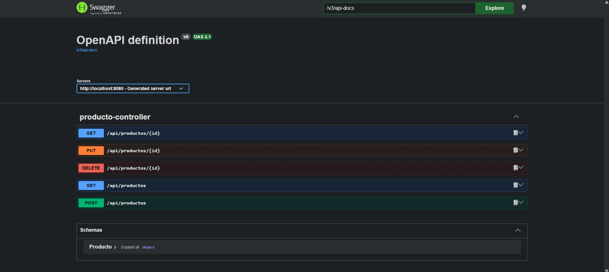
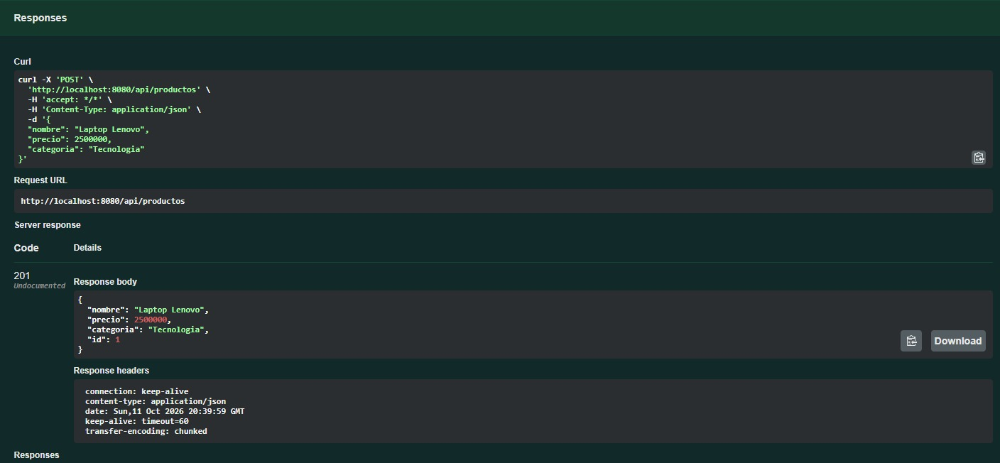
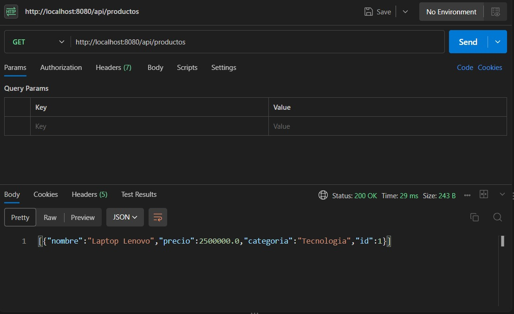
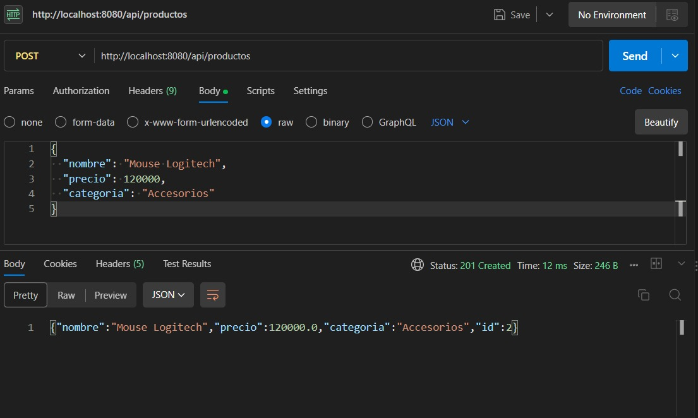
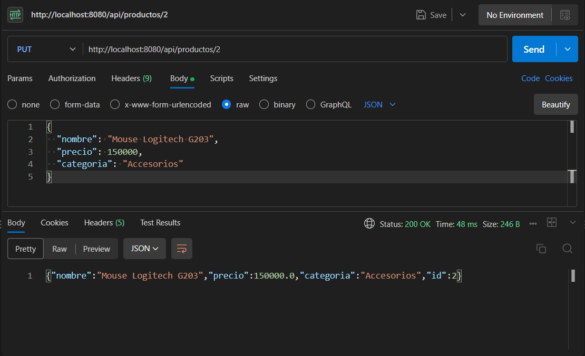
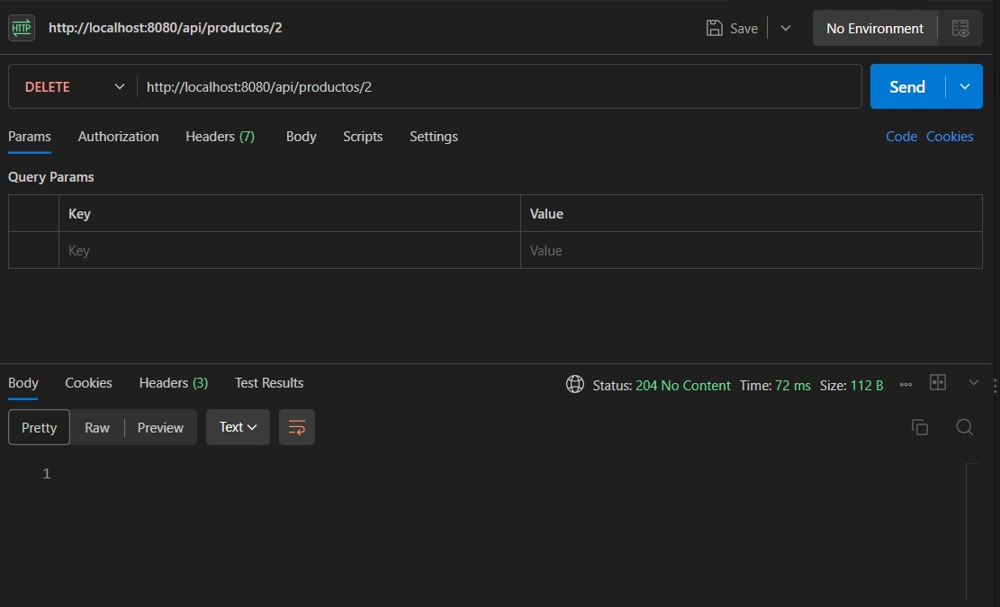
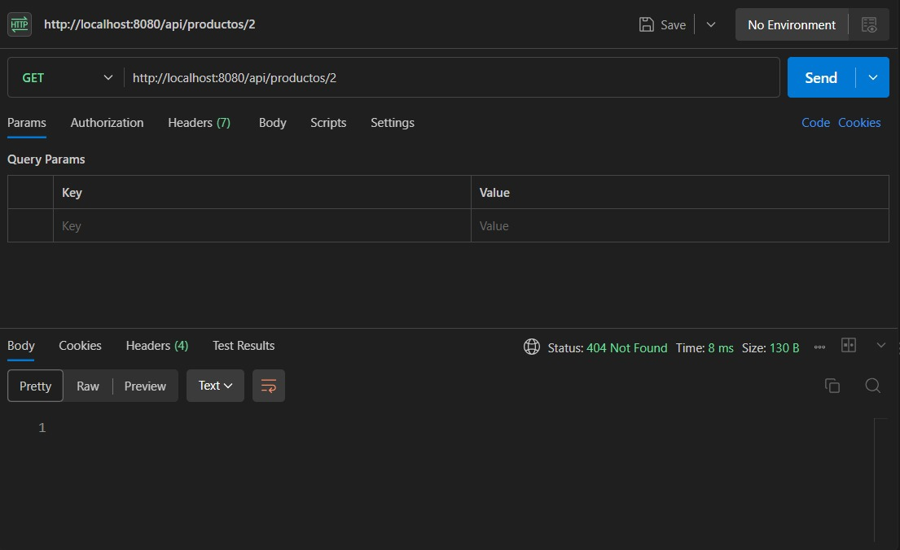

# Parcial práctico — Corte 2

## Desarrollo Fullstack

API REST desarrollada con Spring Boot para gestionar productos mediante una arquitectura en capas.

La aplicación permite crear, consultar, actualizar y eliminar productos utilizando métodos HTTP y códigos de estado apropiados.

---

## Technologies

- Java 17
- Spring Boot 4.1.1
- Spring Web
- Spring Data JPA
- H2 Database
- Jakarta Validation
- Swagger / OpenAPI
- Postman
- Maven

---

# Problem 1 — Model and Data Layer

## Entity

The `Producto` entity represents a product stored in the database.

```java
@Entity
public class Producto {

    @Id
    @GeneratedValue(strategy = GenerationType.IDENTITY)
    private Long id;

    @NotBlank(message = "El nombre es obligatorio")
    private String nombre;

    @NotNull(message = "El precio es obligatorio")
    @Positive(message = "El precio debe ser mayor que cero")
    private Double precio;

    @NotBlank(message = "La categoria es obligatoria")
    private String categoria;
}
```

The entity contains the following attributes:

| Attribute | Type | Description |
|---|---|---|
| `id` | Long | Unique product identifier |
| `nombre` | String | Product name |
| `precio` | Double | Product price |
| `categoria` | String | Product category |

---

## Repository

The repository extends `JpaRepository`, which provides the standard CRUD operations.

```java
public interface ProductoRepository extends JpaRepository<Producto, Long> {

    List<Producto> findByNombreContainingIgnoreCase(String nombre);
}
```

The following method-name query was implemented:

```java
findByNombreContainingIgnoreCase(String nombre)
```

Spring Data JPA interprets the method name automatically and generates the query needed to search products whose name contains the specified text, ignoring uppercase and lowercase differences.

Example:

```text
GET /api/productos?nombre=Lenovo
```

---

## Object-Relational Mapping — ORM

Object-Relational Mapping allows Java objects to be associated with database tables.

In this project, the `Producto` Java class is mapped as a persistent entity using:

```java
@Entity
```

The `id` attribute is identified as the primary key using:

```java
@Id
```

Its value is automatically generated using:

```java
@GeneratedValue(strategy = GenerationType.IDENTITY)
```

Conceptually, the mapping is:

| Java | Relational Database |
|---|---|
| `Producto` class | PRODUCTO table |
| `id` | ID column / Primary Key |
| `nombre` | NOMBRE column |
| `precio` | PRECIO column |
| `categoria` | CATEGORIA column |

JPA and Hibernate are responsible for converting Java objects into database records and database records back into Java objects.

---

# Problem 2 — REST Endpoints

The application follows a layered architecture:

```text
Controller
    ↓
Service
    ↓
Repository
    ↓
Database
```

The base URL is:

```text
/api/productos
```

URLs use nouns instead of actions, following REST conventions.

## CRUD Endpoints

| HTTP Method | Endpoint | Operation | Status |
|---|---|---|---|
| GET | `/api/productos` | List all products | `200 OK` |
| GET | `/api/productos/{id}` | Get one product | `200 OK` |
| GET | `/api/productos/{id}` | Product not found | `404 Not Found` |
| POST | `/api/productos` | Create product | `201 Created` |
| POST | `/api/productos` | Invalid data | `400 Bad Request` |
| PUT | `/api/productos/{id}` | Update product | `200 OK` |
| PUT | `/api/productos/{id}` | Product not found | `404 Not Found` |
| DELETE | `/api/productos/{id}` | Delete product | `204 No Content` |
| DELETE | `/api/productos/{id}` | Product not found | `404 Not Found` |

---

## GET — List Products

```text
GET /api/productos
```

Returns all products stored in the database.

Expected status:

```text
200 OK
```

---

## GET — Product by ID

```text
GET /api/productos/{id}
```

Example:

```text
GET /api/productos/1
```

If the product exists:

```text
200 OK
```

If the product does not exist:

```text
404 Not Found
```

---

## POST — Create Product

```text
POST /api/productos
```

Example JSON body:

```json
{
  "nombre": "Laptop Lenovo",
  "precio": 2500000,
  "categoria": "Tecnologia"
}
```

Expected response:

```text
201 Created
```

Example response:

```json
{
  "id": 1,
  "nombre": "Laptop Lenovo",
  "precio": 2500000.0,
  "categoria": "Tecnologia"
}
```

---

## PUT — Update Product

```text
PUT /api/productos/{id}
```

Example:

```text
PUT /api/productos/1
```

JSON body:

```json
{
  "nombre": "Laptop Lenovo ThinkPad",
  "precio": 2800000,
  "categoria": "Tecnologia"
}
```

If the product exists:

```text
200 OK
```

If the product does not exist:

```text
404 Not Found
```

---

## DELETE — Delete Product

```text
DELETE /api/productos/{id}
```

Example:

```text
DELETE /api/productos/1
```

If the product exists:

```text
204 No Content
```

If the product does not exist:

```text
404 Not Found
```

---

## English Requirement

The controller receives HTTP requests and returns the appropriate HTTP responses to the client. The service contains the application logic and coordinates the operations between the controller and the data layer. The repository provides access to the database using Spring Data JPA.

---

# Problem 3 — Documentation and Testing

## Swagger / OpenAPI

Swagger was integrated into the project using `springdoc-openapi`.

The dependency used in `pom.xml` is:

```xml
<dependency>
    <groupId>org.springdoc</groupId>
    <artifactId>springdoc-openapi-starter-webmvc-ui</artifactId>
    <version>3.1.1</version>
</dependency>
```

Swagger UI is available at:

```text
http://localhost:8080/swagger-ui.html
```

The OpenAPI specification is available at:

```text
http://localhost:8080/v3/api-docs
```

Swagger automatically detects the REST controller and documents the available endpoints.

---

## Swagger Evidence

The following image shows the documented REST endpoints.



---

## POST Test with Swagger

A product was created using:

```text
POST /api/productos
```

Expected status:

```text
201 Created
```



---

# Postman Tests

Postman was used to test the API endpoints and verify the HTTP status codes.

## Test 1 — GET Products

Request:

```text
GET http://localhost:8080/api/productos
```

Expected result:

```text
200 OK
```



---

## Test 2 — POST Product

Request:

```text
POST http://localhost:8080/api/productos
```

JSON body:

```json
{
  "nombre": "Mouse Logitech",
  "precio": 120000,
  "categoria": "Accesorios"
}
```

Expected result:

```text
201 Created
```



---

## Test 3 — PUT Product

Request:

```text
PUT http://localhost:8080/api/productos/2
```

JSON body:

```json
{
  "nombre": "Mouse Logitech G203",
  "precio": 150000,
  "categoria": "Accesorios"
}
```

Expected result:

```text
200 OK
```



---

## DELETE Test

Request:

```text
DELETE http://localhost:8080/api/productos/2
```

Expected result:

```text
204 No Content
```



---

# Error Cases

## Error Case 1 — 404 Not Found

After deleting product with ID `2`, the following request was executed:

```text
GET http://localhost:8080/api/productos/2
```

The API correctly returned:

```text
404 Not Found
```



---

## Error Case 2 — 400 Bad Request

Validation was also tested using invalid data.

Request:

```text
POST http://localhost:8080/api/productos
```

JSON body:

```json
{
  "nombre": "",
  "precio": -500,
  "categoria": ""
}
```

The API returned:

```text
400 Bad Request
```

because the entity uses validation annotations such as:

```java
@NotBlank
@NotNull
@Positive
```


---

# How to Run

From the project directory on Windows PowerShell:

```powershell
.\mvnw spring-boot:run
```

On macOS or Linux:

```bash
./mvnw spring-boot:run
```

The API runs at:

```text
http://localhost:8080
```

Swagger UI:

```text
http://localhost:8080/swagger-ui.html
```

---

# Project Structure

```text
producto-api/
│
├── src/
│   └── main/
│       ├── java/
│       │   └── com/
│       │       └── fullstack/
│       │           └── productoapi/
│       │               ├── controller/
│       │               │   └── ProductoController.java
│       │               ├── entity/
│       │               │   └── Producto.java
│       │               ├── repository/
│       │               │   └── ProductoRepository.java
│       │               ├── service/
│       │               │   └── ProductoService.java
│       │               └── ProductoApiApplication.java
│       └── resources/
│           └── application.properties
│
├── evidences/
│   ├── 01-swagger-endpoints.jpeg
│   ├── 02-swagger-post-201.jpeg
│   ├── 03-postman-get-200.jpeg
│   ├── 04-postman-post-201.jpeg
│   ├── 05-postman-put-200.jpeg
│   ├── 06-postman-delete-204.jpeg
│   ├── 07-postman-error-404.jpeg
│   └── 08-postman-error-400.jpeg
│
├── pom.xml
├── mvnw
├── mvnw.cmd
└── README.md
```

---

# Conclusion

The project implements a complete REST CRUD API using Spring Boot and a layered architecture.

Spring Data JPA provides persistence and object-relational mapping, while the service layer contains the application logic and the controller exposes the REST endpoints.

Swagger is used to document the API and Postman is used to verify successful responses and error cases.

The implementation covers entity mapping, repository access, application logic, CRUD operations, HTTP status codes, validation, API documentation and endpoint testing.